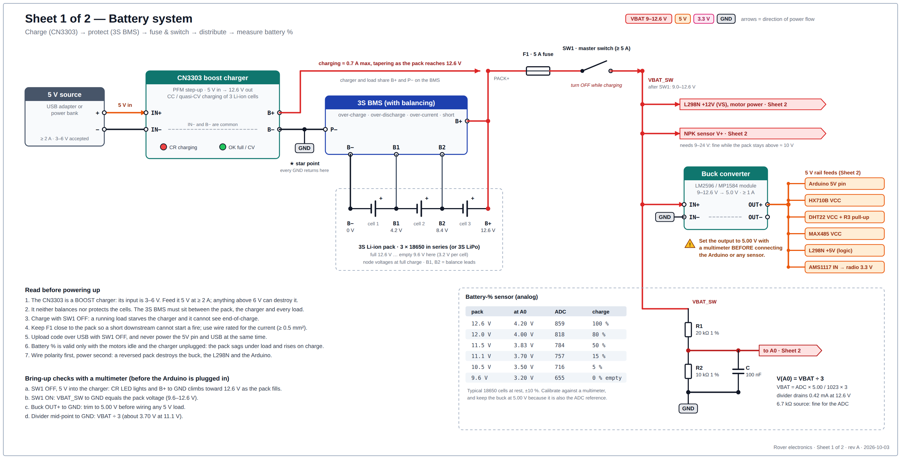
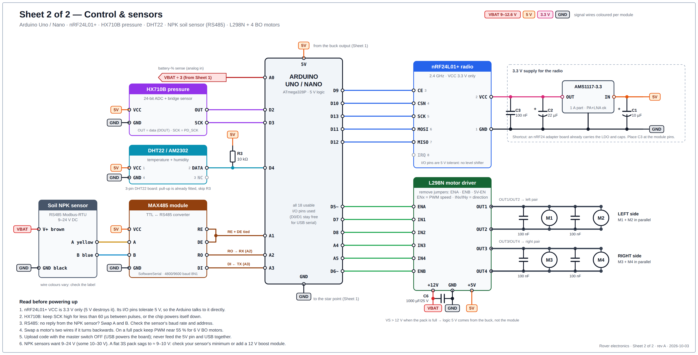

# Rover electronics: circuit diagrams

Wiring for an Arduino Uno/Nano rover with an **nRF24L01+** radio, **HX710B** pressure sensor, **DHT22**, **NPK soil sensor** (RS485), an **L298N** driving **4 BO motors**, a **3S Li-ion pack charged by a CN3303** boost-charger module, and an **analog battery-% circuit**.

| Sheet | What it shows |
|---|---|
| [Sheet 1: Battery system](01-power-and-charging.svg) | 5 V source → CN3303 → 3S BMS → 3S pack → fuse + master switch → motor power, NPK supply, 5 V buck, battery-% divider |
| [Sheet 2: Control & sensors](02-control-and-sensors.svg) | Arduino + nRF24L01+ (with its 3.3 V LDO), HX710B, DHT22, MAX485 + NPK sensor, L298N and the four motors |





The SVGs are vector (zoom as far as you like, or edit them in Inkscape or any text editor). The PNGs are the same drawings at 3240 px wide.

## What the drawing assumes

- **Arduino Uno or Nano** (ATmega328P, 5 V logic). The design uses **all 18 usable I/O pins**; D0/D1 stay free for USB serial. If you need more pins, use a Mega 2560, but its SPI pins are 50–52, not 11–13.
- **One L298N drives all four BO motors** as two parallel pairs (left pair on OUT1/OUT2, right pair on OUT3/OUT4), like a 4WD chassis. Driving every motor independently needs a second L298N and six more pins.
- **The CN3303 is a boost (step-up) charger**: 3–6 V in, 12.6 V CC/CV out. It runs from a 5 V source of at least 2 A (USB adapter or power bank), **not** from a 12–19 V adapter. It does no cell balancing or protection, so a 3S BMS sits between it and the pack.
- **The NPK sensor is the common RS485 Modbus-RTU type** (9–24 V supply), read through a MAX485 module.
- The 5 V rail comes from a buck converter. The nRF24L01+ gets its own 3.3 V LDO because the Arduino's 3V3 pin (about 50 mA) cannot feed a PA+LNA module.

## Arduino pin map

| Pin | Connects to | Notes |
|---|---|---|
| 5V | buck converter output | do not feed the 5V pin and USB at the same time |
| GND | star ground | |
| D2 | HX710B OUT (DOUT) | |
| D3 | HX710B SCK | keep SCK high < 60 µs or the chip powers down |
| D4 | DHT22 DATA | 10 kΩ pull-up to 5 V |
| D5 `~` | L298N ENA | PWM, left-pair speed |
| D6 `~` | L298N ENB | PWM, right-pair speed |
| D7 | L298N IN1 | |
| D8 | L298N IN2 | |
| D9 | nRF24 CE | |
| D10 | nRF24 CSN | |
| D11 | nRF24 MOSI | hardware SPI |
| D12 | nRF24 MISO | hardware SPI |
| D13 | nRF24 SCK | hardware SPI |
| A0 | battery divider midpoint | VBAT ÷ 3 |
| A1 | MAX485 DE + RE (tied together) | |
| A2 | MAX485 RO | SoftwareSerial RX |
| A3 | MAX485 DI | SoftwareSerial TX |
| A4 | L298N IN3 | |
| A5 | L298N IN4 | |

## Wiring list: control and sensors (Sheet 2)

| Module | Pin | Connects to |
|---|---|---|
| **nRF24L01+** | 1 GND | GND |
| | 2 VCC | 3.3 V from the AMS1117 (never 5 V) |
| | 3 CE / 4 CSN | D9 / D10 |
| | 5 SCK / 6 MOSI / 7 MISO | D13 / D11 / D12 |
| | 8 IRQ | not connected |
| **AMS1117-3.3** | IN | 5 V, 10 µF to GND |
| | OUT | nRF24 VCC, 22 µF to GND, plus 100 nF right at the module pins |
| **HX710B module** | VCC / GND | 5 V / GND |
| | OUT (DOUT) / SCK | D2 / D3 |
| **DHT22** | 1 VCC / 4 GND | 5 V / GND |
| | 2 DATA | D4, plus 10 kΩ to 5 V (skip on 3-pin boards that have it fitted) |
| | 3 NC | not connected |
| **MAX485 module** | VCC / GND | 5 V / GND |
| | RE + DE (tied together) | A1 |
| | RO / DI | A2 / A3 |
| | A / B | NPK sensor A (yellow) / B (blue) |
| **NPK sensor** | V+ (brown) | VBAT after SW1 |
| | GND (black) | GND |
| | A (yellow) / B (blue) | MAX485 A / B |
| **L298N** | +12V | VBAT after SW1, plus 1000 µF / 25 V across +12V and GND |
| | GND | GND |
| | +5V | 5 V from the buck (5V-EN jumper removed) |
| | ENA / ENB | D5 / D6 (jumpers removed) |
| | IN1 / IN2 / IN3 / IN4 | D7 / D8 / A4 / A5 |
| | OUT1, OUT2 | left motors M1 and M2 in parallel |
| | OUT3, OUT4 | right motors M3 and M4 in parallel |

Solder a 100 nF ceramic capacitor across each motor's terminals. The common red L298N module already has its flyback diodes; a bare L298 chip needs eight external fast diodes.

L298N direction: `IN1 = H, IN2 = L` is forward, `L, H` is reverse, equal levels brake. The `EN` pin's PWM duty sets the speed, and `EN` low lets the motor coast. Swap a motor's two wires if it runs backwards.

## Wiring list: battery system (Sheet 1)

| From | To |
|---|---|
| 5 V source + / − | CN3303 IN+ / IN− |
| CN3303 B+ | pack + node (BMS B+) |
| CN3303 B− | BMS P− |
| BMS B−, B1, B2, B+ | cell 1 −, between cells 1 and 2, between cells 2 and 3, cell 3 + |
| pack + node | F1 (5 A) → SW1 (master switch) → **VBAT_SW** |
| BMS P− | star ground: every GND on both sheets returns here |
| VBAT_SW | L298N +12V, NPK V+, buck IN+, R1 |
| buck OUT+ | 5 V rail (set it to 5.00 V with a multimeter first) |
| R1 20 kΩ → midpoint → R2 10 kΩ → GND | midpoint to A0, 100 nF from midpoint to GND |

Power flow: charging is 5 V → CN3303 → pack; running is pack → F1 → SW1 → loads. SW1 sits after the charger connection, so the pack charges with the robot switched off.

## Battery %

The divider gives `V(A0) = VBAT ÷ 3`: 12.6 V → 4.20 V, 9.6 V → 3.20 V, and it stays under 5 V up to a 15 V pack. Its 6.7 kΩ source impedance is inside the ATmega's 10 kΩ limit, and it draws 0.42 mA at 12.6 V.

| Pack | At A0 | ADC (5 V ref) | Charge |
|---|---|---|---|
| 12.6 V | 4.20 V | 859 | 100 % |
| 12.0 V | 4.00 V | 818 | 80 % |
| 11.5 V | 3.83 V | 784 | 50 % |
| 11.1 V | 3.70 V | 757 | 15 % |
| 10.5 V | 3.50 V | 716 | 5 % |
| 9.6 V | 3.20 V | 655 | 0 % (treat as empty) |

The percentages are typical for 18650 cells at rest (about ±10 %). Read it with the motors idle and the charger unplugged: the pack sags under load and reads high while charging.

## Pin definitions and battery helper

```cpp
// nRF24L01+ on hardware SPI (D11 MOSI, D12 MISO, D13 SCK)
const uint8_t NRF_CE = 9, NRF_CSN = 10;       // RF24 radio(NRF_CE, NRF_CSN);
const uint8_t HX_DOUT = 2, HX_SCK = 3;        // HX710B
const uint8_t DHT_PIN = 4;                    // DHT22
const uint8_t RS485_DE_RE = A1;               // MAX485 DE + RE
const uint8_t RS485_RX = A2, RS485_TX = A3;   // SoftwareSerial rs485(RS485_RX, RS485_TX);
const uint8_t ENA = 5, IN1 = 7, IN2 = 8;      // L298N left pair  (ENA is PWM)
const uint8_t IN3 = A4, IN4 = A5, ENB = 6;    // L298N right pair (ENB is PWM)
const uint8_t VBAT_PIN = A0;                  // divider midpoint

float readPackVolts() {                       // trim 5.00 and 3.0 against a multimeter
  uint32_t sum = 0;
  for (uint8_t i = 0; i < 16; i++) sum += analogRead(VBAT_PIN);
  return (sum / 16.0) * (5.00 / 1023.0) * 3.0;
}

uint8_t packPercent(float v) {                // piecewise-linear, same points as the table
  static const float V[] = {9.6, 10.5, 11.1, 11.5, 12.0, 12.6};
  static const uint8_t P[] = {0, 5, 15, 50, 80, 100};
  if (v <= V[0]) return 0;
  if (v >= V[5]) return 100;
  for (uint8_t i = 1; i < 6; i++)
    if (v <= V[i]) return P[i - 1] + (P[i] - P[i - 1]) * (v - V[i - 1]) / (V[i] - V[i - 1]);
  return 100;
}
```

## Parts list

| Qty | Part | Notes |
|---|---|---|
| 1 | Arduino Uno or Nano | |
| 1 | nRF24L01+ module | plain or PA+LNA |
| 1 | AMS1117-3.3 module (or an nRF24 adapter board) | plus 10 µF, 22 µF (tantalum or low-ESR) and 100 nF |
| 1 | HX710B + MPS20N0040D pressure module | |
| 1 | DHT22 (AM2302) | plus 10 kΩ pull-up for the bare 4-pin part |
| 1 | NPK soil sensor, RS485 Modbus-RTU | check its supply range and baud rate |
| 1 | MAX485 TTL ↔ RS485 module | |
| 1 | L298N dual H-bridge module | plus 1000 µF / 25 V |
| 4 | BO motors | plus 4 × 100 nF ceramic |
| 1 | CN3303 3S boost charger module | 5 V in, 12.6 V out |
| 1 | 5 V USB adapter or power bank, ≥ 2 A | |
| 1 | 3S BMS with balancing, ≥ 10 A | |
| 3 | 18650 Li-ion cells in series (3S1P) with holder | or one 3S LiPo with balance lead |
| 1 | LM2596 or MP1584 buck module | set to 5.00 V |
| 1 | Fuse F1 5 A with holder | sized for four BO motors at about 1 A stall each; resize for yours |
| 1 | Master switch SW1, ≥ 5 A | |
| 2 | R1 20 kΩ and R2 10 kΩ, 1 % | plus 100 nF for the divider |

## Check against your hardware

- **CN3303 module.** The environment this was drawn in could not open the CN3303 datasheet, so the charger is drawn at module level, using the terminal and LED names common to 3S CN3303 boards (IN+ / IN− / B+ / B−, CR / OK) and the "about 0.7 A" figure from vendor listings. Match them to your board's silkscreen and rating before powering it. If you build around the bare SOP-8 chip, use the datasheet's typical-application circuit instead.
- **HX710B module.** Pin order differs between boards; wire by the printed labels (VCC, GND, OUT/DT, SCK), not by position.
- **NPK sensor.** Wire colours, supply range (9–24 V, 10–30 V or 12 V only), baud rate and Modbus address vary by maker. If yours needs more than the pack can give when low, add a 12 V boost module.
- **BO motors.** On a full pack the L298N output is about 10.5 V. For 6 V motors keep PWM near 55 % (`analogWrite` ≈ 140).

## References

- CN3303 as a PFM step-up 3-cell charger: [Sekorm listing](https://en.sekorm.com/doc/3692731.html), [DNA Tech India listing](https://www.dnatechindia.com/cn3303-pfm-three-cell-lithium-battery-ic.html), [Consonance CN3303 datasheet v2.1, hosted by Make Electronics (not opened here)](https://make.net.za/wp-content/datasheets/Consonance%20Elec%20CN3303%20Datasheet%20v2.1.pdf)
- 3S CN3303 charger module (3–6 V in, 12.6 V out, IN+/IN−/B+/B−, CR and OK LEDs): [Micro Robotics listing](https://www.robotics.org.za/CN3303)
- HX710B pins, 25/26/27-pulse modes and the 60 µs power-down rule: [Components101](https://components101.com/ics/hx710b-24-bit-adc-forweighing-scale-applications), [Homemade Circuits](https://www.homemade-circuits.com/hx710b-air-pressure-sensor-datasheet-how-to-connect/), [SWHarden](https://swharden.com/blog/2022-11-14-hx710b-arduino/)
